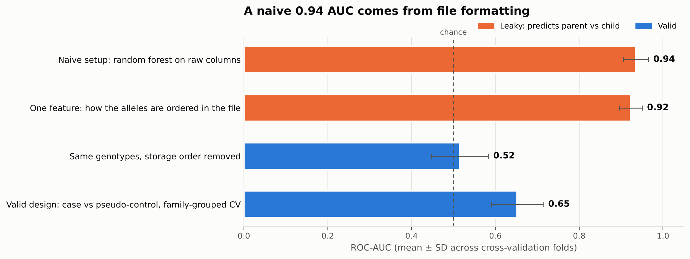
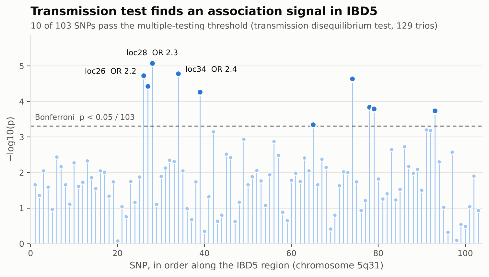
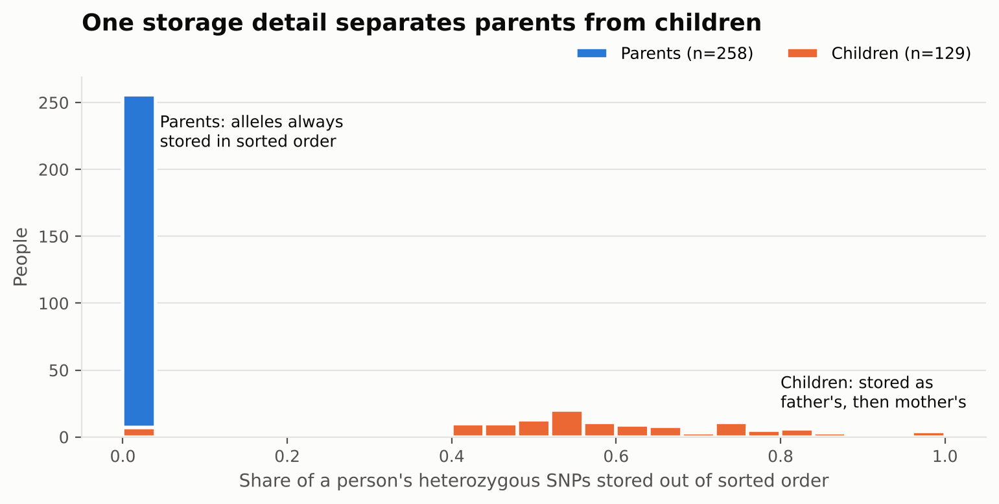
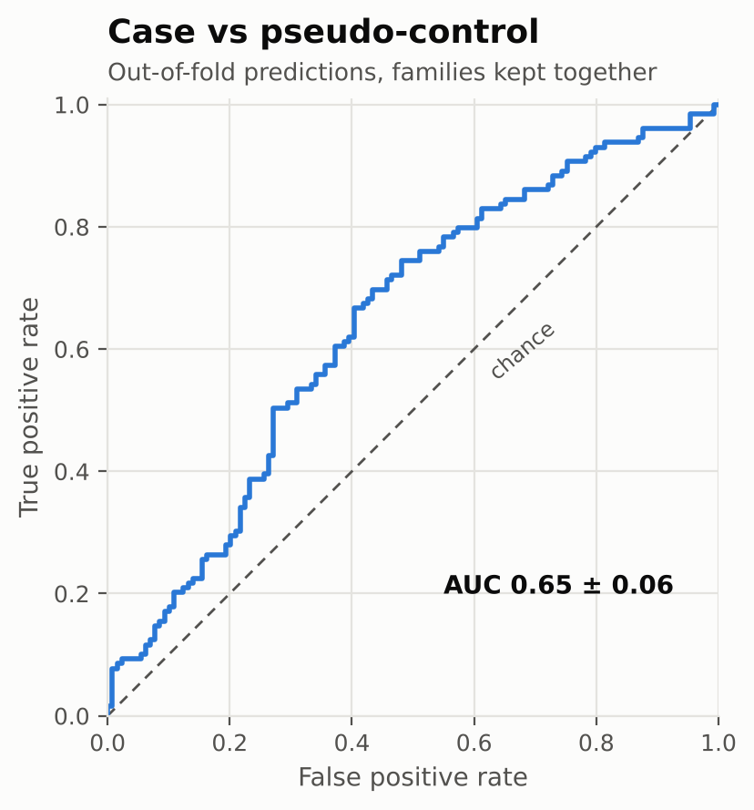

# Althea — Crohn's disease genetics, done carefully

Althea analyses a family-based genetic dataset for Crohn's disease. It does three things:

1. **Finds the association signal** using the test the study design calls for: the transmission disequilibrium test (TDT).
2. **Audits for data leakage.** A naive classifier on the raw data scores 0.94 ROC-AUC. Althea shows that this score comes from how the file is formatted, not from genetics.
3. **Builds a valid predictive baseline** (case vs pseudo-control, family-grouped cross-validation) that reaches an honest **0.65 AUC**.



---

## The data

`data/crohn.csv` is a public Crohn's disease dataset from Daly et al. (2001), as distributed with the R package `gap`. It has 387 people in **129 parent–parent–child trios**, genotyped at **103 SNPs** across the IBD5 region on chromosome 5q31.

| Who | Rows | `crohn` value | What it means |
|---|---|---|---|
| Affected children | 129 | 2 | Crohn's disease |
| Parents, affected | 15 | 2 | Crohn's disease |
| Parents, status not recorded | 243 | 0 | **Unknown**, not "healthy" |

Each SNP is stored as two allele columns (`locN.a1`, `locN.a2`), with alleles coded 1–4 and 0 for missing.

## 1. Association: the transmission disequilibrium test

In trio data, the right question is not "do patients differ from other people?". It is "**which allele did each parent pass on to the affected child?**". A heterozygous parent passes each allele on 50% of the time by chance. If one allele goes to affected children more often than that, it is linked to the disease. Comparing a child with their own parents also rules out confounding from ancestry (population stratification).



**10 of 103 SNPs pass Bonferroni correction** (p < 0.05/103 ≈ 4.9 × 10⁻⁴). The strongest:

| SNP | Minor allele transmitted | Not transmitted | Transmission OR | p |
|---|---|---|---|---|
| loc28 | 88 | 38 | 2.32 | 8.4 × 10⁻⁶ |
| loc34 | 80 | 34 | 2.35 | 1.6 × 10⁻⁵ |
| loc26 | 90 | 41 | 2.20 | 1.9 × 10⁻⁵ |
| loc74 | 82 | 36 | 2.28 | 2.3 × 10⁻⁵ |
| loc27 | 82 | 37 | 2.22 | 3.7 × 10⁻⁵ |

The cluster of hits at loc26–loc39 and loc74–loc79 is consistent with the IBD5 risk haplotype reported for this region. Full results are in [`results/tdt_results.csv`](results/tdt_results.csv).

## 2. Leakage audit: why a naive model scores 0.94

The obvious approach is to treat `crohn = 0` as "healthy control" and train a classifier on the raw columns. That scores very well, for two reasons that have nothing to do with disease:

**The labels encode family role.** Every `0` is a parent. A model trained on these labels learns to tell **parents from children**.

**The file stores the two groups' alleles differently.** Children are *phased*: `a1` is the allele from the father and `a2` the allele from the mother. Parents' alleles are stored in a *fixed sorted order*. So the order of the two columns gives away who is a child:



| Model (repeated 5-fold CV) | ROC-AUC |
|---|---|
| Naive setup: random forest on raw columns | 0.94 ± 0.03 |
| Naive setup: logistic regression on raw columns | 0.91 ± 0.04 |
| **One feature**: share of a person's alleles stored out of sorted order | **0.92 ± 0.03** |
| Same genotypes, order removed (minor-allele counts), logistic regression | 0.52 ± 0.07 |
| Same genotypes, order removed, random forest | 0.42 ± 0.05 |

One formatting feature matches the full model. Once the storage order is removed, the same genotypes classify at chance. A further 15 affected parents are stored like parents, so the leaky model calls them "controls". That is why the leaky score stops short of 1.0.

## 3. A valid predictive baseline

To ask a fair predictive question, each affected child is paired with a **pseudo-control**: the genotype made from the two alleles their parents did *not* pass on. It is like a genetic sibling with the same parents and ancestry who didn't inherit the child's alleles.

- 129 cases vs 129 pseudo-controls, using minor-allele counts (order-free)
- L2-regularised logistic regression, with C tuned in a nested inner loop
- Outer loop: 5-fold `StratifiedGroupKFold` repeated 10 times, **keeping both members of a family in the same fold**



**ROC-AUC 0.65 ± 0.06.** That's a real but modest signal. 103 SNPs in one region carry some information about inheritance of risk, and they are nowhere near a diagnostic test. This matches what is known about complex diseases like Crohn's, where many loci each contribute a small effect.

---

## Quickstart

```bash
python -m venv .venv && source .venv/bin/activate
pip install -r requirements.txt
python run.py        # ~1 minute; writes results/ and figures/
pytest -q            # 6 tests
```

## Project structure

```
├── data/crohn.csv              # raw trio data
├── src/
│   ├── data.py                 # loading, trio structure, order-free encoding, pseudo-controls
│   ├── tdt.py                  # transmission disequilibrium test
│   ├── audit.py                # leakage audit of a naive setup
│   ├── model.py                # case vs pseudo-control model, nested grouped CV
│   └── plots.py                # figures
├── tests/test_althea.py        # encoding, TDT, phasing and label checks
├── results/                    # tdt_results.csv, metrics.json
├── figures/                    # PNGs used in this README
└── run.py                      # runs everything
```

## Limitations

- **Small sample.** 129 trios gives limited power, so the TDT will miss weaker effects and the AUC estimate is noisy (fold range roughly 0.54–0.77).
- **No physical positions.** SNPs are plotted in marker order, not base-pair position, because the dataset doesn't include coordinates.
- **Correlated SNPs.** SNPs in this region are in strong linkage disequilibrium, so Bonferroni is conservative and the 10 hits are not 10 independent signals. A haplotype-based analysis would be the natural next step.
- **Missing genotypes** (about 13% of pseudo-control calls) are mean-imputed inside each training fold.
- **No external replication.** All results come from this single cohort.

## Lessons

- Read what a label code *means* before modelling it. In pedigree files, `0` usually means "unknown".
- Check that an implausibly good score survives a change of encoding.
- Match the method to the study design. Trios call for transmission-based tests and family-grouped validation.

## References

- Spielman RS, McGinnis RE, Ewens WJ (1993). Transmission test for linkage disequilibrium: the insulin gene region and insulin-dependent diabetes mellitus. *Am J Hum Genet* 52:506–516.
- Daly MJ, Rioux JD, Schaffner SF, Hudson TJ, Lander ES (2001). High-resolution haplotype structure in the human genome. *Nature Genetics* 29:229–232.
- Rioux JD et al. (2001). Genetic variation in the 5q31 cytokine gene cluster confers susceptibility to Crohn disease. *Nature Genetics* 29:223–228.

## License

MIT
